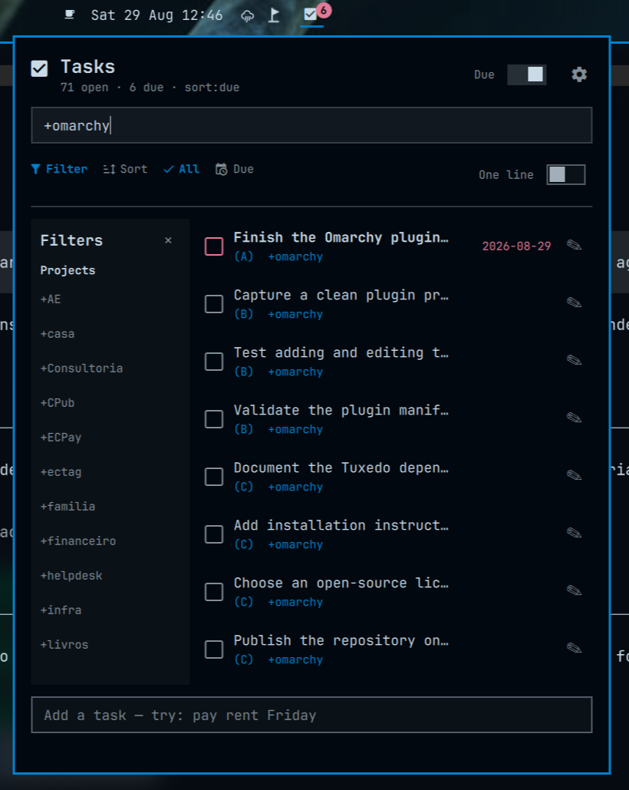

# Omarchy Tuxedo

A focused todo.txt task panel for Omarchy Quattro, powered by the [Tuxedo](https://github.com/webstonehq/tuxedo) command-line interface. Omarchy Tuxedo places your open-task count in the bar and lets you browse and update your task file without leaving the desktop.

## Features

- Shows the number of open tasks in the bar, with an optional due-only badge
- Searches tasks and filters them by due status, project (`+project`), or context (`@context`)
- Sorts by due date, file order, or priority
- Highlights due and overdue tasks and recognizes todo.txt priorities
- Adds, edits, completes, and deletes tasks through Tuxedo
- Supports multi-select completion and deletion
- Switches between compact one-line and two-line task descriptions
- Watches the configured todo.txt file and refreshes when it changes
- Follows the active Omarchy theme

## Screenshot



## Requirements

- Omarchy Quattro
- The external [`tuxedo` CLI](https://github.com/webstonehq/tuxedo/releases/latest) installed and available on your `PATH`

Download and install the appropriate Tuxedo release for your system before using the widget.

## Installation

Install the plugin from GitHub and enable it immediately:

```bash
omarchy plugin add https://github.com/lpanebr/omarchy-tuxedo-todo.git --enable
```

The widget is registered as **Omarchy Tuxedo** in the Productivity category. It supports one instance and defaults to the center section of the bar.

## Usage

Click the checklist icon in the bar to open the panel.

- Type in **Search tasks** to narrow the visible list.
- Use **Filter** to select a discovered project or context, or choose **Due** to show tasks due today or earlier.
- Click **Sort** to cycle through due-date, file-order, and priority sorting.
- Enter text in **Add a task** and press Enter to create a task.
- Click a task row to select it; selected tasks can be completed or deleted together.
- Use the checkbox beside a task to complete it immediately, or the pencil button to edit it.
- Open **Settings** with the gear button to choose a different todo.txt file.

Completed tasks are handled by Tuxedo and use `done.txt` in the same directory as the configured todo file. Batch deletion is performed with Tuxedo's forced-delete option, so review the selection before deleting.

## todo.txt location and configuration

By default, the plugin reads:

```text
~/todo.txt
```

To use another file, open the panel settings and enter its absolute path. Relative paths are rejected. The chosen path, badge mode, description layout, and sort mode are saved to:

```text
${XDG_STATE_HOME:-~/.local/state}/omarchy/omarchy-tuxedo.json
```

For every Tuxedo action, the plugin sets `TODO_FILE` to the configured path and `DONE_FILE` to `done.txt` beside it. Standard todo.txt metadata such as priorities, `+projects`, `@contexts`, and `due:YYYY-MM-DD` is recognized by the panel.

## Removal

Remove the plugin by its manifest ID:

```bash
omarchy plugin remove omarchy-tuxedo
```

This removes the plugin, not your `todo.txt`, sibling `done.txt`, or saved state file.

## Security and data behavior

Omarchy Tuxedo works locally. The widget reads and watches the configured todo.txt file, invokes the locally installed `tuxedo` executable for changes, and writes only its small JSON preferences file. It does not include network requests, telemetry, account access, or cloud synchronization. Your task data is sent only to local processes started for the requested Tuxedo action.

## License

Released under the [MIT License](LICENSE).
